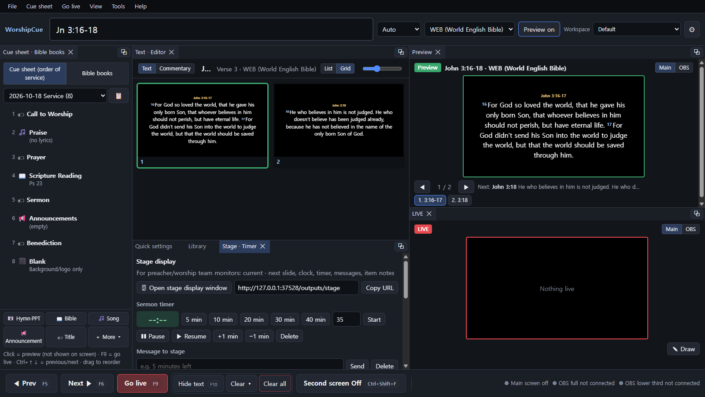
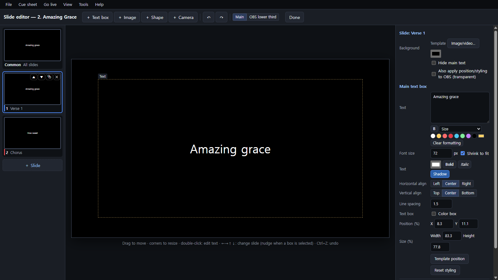
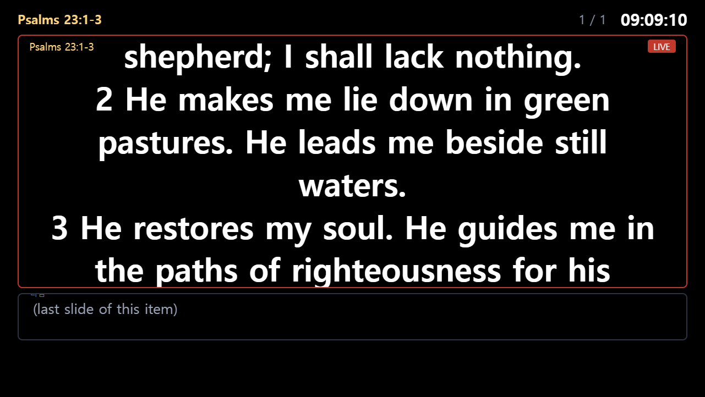

# WorshipCue

[한국어](README.md) | **English**

A **worship presentation program for churches** (Windows).

Build your order of service ahead of time, and during the service you just press **F6**: Bible passages, song lyrics, hymn scores, announcements and videos go out in order to the sanctuary screen (second monitor) and to OBS for streaming.

**⬇ Download**: [Latest release](https://github.com/hahadark/WorshipCue/releases/latest) — Windows `WorshipCue-…-English-Portable.exe` (no install) · Mac `WorshipCue-…-English-mac-arm64.dmg` / `…-x64.dmg` ([macOS notes](#macos)) — includes the **World English Bible (WEB, public domain)** and starts in English.
The Korean build (`WorshipCue-…-Portable.exe`) includes the Korean Revised Version. Both builds contain the same program; switch the language any time in `View → 🌐 Language`.



<sub>Left: cue sheet (order of service) · center: the selected item's editor and slides · right: Preview (green) and LIVE (red). All names and lyrics are examples.</sub>

## Contents

- [Get started in 5 minutes](#get-started-in-5-minutes)
- [Features](#features)
- [Menus](#menus)
- [Running a service](#running-a-service)
- [Slide editor](#slide-editor)
- [Stage display and phone remote](#stage-display-and-phone-remote)
- [OBS dock](#obs-dock-control-panel-inside-obs) · [macOS](#macos)
- [Keyboard shortcuts](#keyboard-shortcuts)
- [Bible data and copyright](#bible-data-and-copyright)
- [Development](#development)

## Get started in 5 minutes

1. **Download and run** `WorshipCue-…-English-Portable.exe` from [Releases](https://github.com/hahadark/WorshipCue/releases/latest) (no installation). If Windows SmartScreen warns you, click "More info → Run anyway".
2. **Sanctuary screen**: connect a second monitor and click `Second screen` at the bottom (Ctrl+Shift+F). Choose the monitor in `File → ⚙ Settings → Output`.
3. **OBS** (when streaming): add a Browser source with `http://127.0.0.1:37528/outputs/main` (full screen) or `/outputs/overlay` (transparent lower third), 1920×1080.
4. **Make a cue sheet**: add items with the buttons at the bottom left (Hymn·PPT · Bible · Song · Announcement · Title · ＋ More).
5. **During the service**: `F6` next · `F5` previous · `F9` go live · `F10` hide text.

## Features

| | |
|---|---|
| Cue sheet | Bible · songs · hymns/song PPTs · announcements · titles · images · videos · audio · slideshow (pre-service loop) · camera · blank screen, in one list. F6 at the end of an item moves on to the next item. |
| Bible | Search by reference (`John 3:16`, `Jn 3:16-18`, `Ps 23`, `Rom 8:1,28`) or by words. Automatic slide splitting so text never overflows. Parallel translation (two translations at once). |
| Songs | Song library, `[Verse 1]` `[Chorus]` labels with group colors, arrangement (`1 C 2 C C`), number/C/B/E keys to jump to a verse/chorus/bridge/ending while live, chords for the worship team, song credits. Import from OpenLP · ChordPro · ProPresenter 6 · PPT · txt. |
| ✏ Slide editor | FreeShow-style: drag text boxes, add text/images/shapes/camera boxes, per-slide or common styling, insert/duplicate/delete/move slides, ← → to change slides. Works on every item type. |
| ✍ Text formatting | **Ctrl+B bold**, font size and text color right in the lyrics/announcement box. |
| Output | Sanctuary full screen + OBS full + OBS transparent lower third, each with its own template. Dissolve/cut transitions, logo, overlays (clock · countdown · banner), live background (camera · image · video), drawing/highlighting on the live screen. |
| Stage display | Current/next slide, clock, sermon timer, messages, item notes for the preacher and worship team. |
| Phone remote | Next · previous · hide, jump to verses, send cue items, stage messages — from any phone on the same Wi-Fi (PIN). |
| More | Stream Deck / Companion buttons (HTTP), workspaces (saved panel layouts), 5 control-screen themes, drag-and-drop files (including PPT), cue sheet manager (pin · templates · duplicate for next week · trash). |

## Menus

| Menu | Contents |
|---|---|
| File | Manage cue sheets · cue sheet from bulletin (AI) · **Import ▸** (songs · Bible translations) · live history · **⚙ Settings (Ctrl+,)** |
| Cue sheet | **＋ Add item ▸** · selected item (edit F2 · slide editor Ctrl+E · move · duplicate · delete) · show editor · ⏰ service clock |
| Go live | Go live F9 · next/previous slide · next/previous item · **Clear screen ▸** · **Live background ▸** · draw · preview off · second screen |
| View | **Panels ▸** · slides as grid · **Workspaces ▸** · stage display window · control theme · **🌐 Language** |
| Tools | **Library ▸** · stage/sermon timer · Stream Deck · **📱 Phone remote ▸** |
| Help | User guide · OBS guide · shortcuts · about |

Right-click anywhere for the actions that make sense there.

## Running a service

- Click an item in the cue sheet to put it in **Preview** (it does **not** go to the screen). Send it live with `Go live` (F9) or `Next` (F6).
- ← → move through preview slides; the slide grid (`Grid`) shows thumbnails — hover a thumbnail for **＋** (new slide after it) and **✕** (delete / skip).
- `Clear ▾` at the bottom: clear background · overlays off · logo screen · stop audio. `Clear all` clears everything.
- Click the second-screen window itself and press **Esc** to turn it off.

## Slide editor



Open it with `✎ Slide editor` in the item editor, the ✎ on a thumbnail, or **Ctrl+E**.

- Drag text boxes, resize from the corners, double-click to edit text (changes go straight into the lyrics/announcement).
- `＋ Text box` `＋ Image` `＋ Shape` `＋ Camera`; **Common** applies to all slides, a single slide's styling wins.
- Songs/announcements/titles: `＋ Slide` (Ctrl+Shift+N), ▲ ▼ ⧉ ✕ to move, duplicate, delete.
- Bible/hymn/image items: the original text stays; add title-card slides in between, or ⊘ skip slides you don't need.
- ← → ↑ ↓ change slides (they nudge the selected box instead when a box is selected; Esc deselects).

## Stage display and phone remote



- `View → 🖥 Open stage display` and drag the window to the preacher's monitor, or open `http://127.0.0.1:37528/outputs/stage` in a browser/OBS on this PC.
- `Tools → 📱 Phone remote` → turn on → scan the QR code and enter the PIN (same Wi-Fi). If Windows Firewall asks, allow "Private networks".

## OBS dock (control panel inside OBS)

1. Copy the **OBS dock** URL `http://127.0.0.1:37528/dock` from `Settings → Output`.
2. In OBS: `Docks → Custom Browser Docks` → name `WorshipCue`, paste the URL → Apply.
3. You get the current/next slide, ◀ Prev · Next ▶ · hide text, verse/chorus jumps, the cue sheet (tap to go live) and stage messages right inside OBS.

It only works on this PC, so no PIN is needed. Turning off the second screen also hides the slide in OBS browser sources (can be turned off in `Settings → Output`).

## macOS

- Download `WorshipCue-…-English-mac-arm64.dmg` (Apple Silicon: M1/M2/M3…) or `…-English-mac-x64.dmg` (Intel) from [Releases](https://github.com/hahadark/WorshipCue/releases/latest), open it and drag WorshipCue to `Applications`.
- **First launch**: the app isn't signed with an Apple Developer certificate, so macOS warns about an unidentified developer. Right-click (Control-click) WorshipCue in `Applications` → **Open** → **Open**. (macOS 15+: try opening once, then `System Settings → Privacy & Security` → **Open Anyway**.) If it says the app "is damaged", run `xattr -cr /Applications/WorshipCue.app` once in Terminal.
- **Shortcuts**: Ctrl on Windows is **⌘ (Command)** on Mac (⌘K search · ⌘E slide editor · ⌘B bold · ⌘⇧F second screen), and the app shows ⌘. On MacBooks press **fn** with F5/F6/F9/F10, or turn on "Use F1, F2, etc. keys as standard function keys" in `System Settings → Keyboard → Keyboard Shortcuts → Function Keys`. All shortcuts can be changed in `Settings → Shortcuts`.
- **Camera**: macOS asks for camera permission the first time. If you denied it, enable WorshipCue in `System Settings → Privacy & Security → Camera`.
- Not available on Mac: reading hymn PPTs "as shown" (needs PowerPoint on Windows; Mac uses the Auto mode).

## Keyboard shortcuts

| Key | Action |
|---|---|
| F6 / F5 | Next / previous slide (at the end of an item: next item) |
| F9 · double-click a slide | Go live |
| F10 | Hide / show text |
| ← / → · PageUp / PageDown | Previous / next preview slide |
| Ctrl+↓ / Ctrl+↑ | Preview next / previous cue item |
| 1–9 · C · B · E (song live) | Jump to verse · chorus · bridge · ending |
| Ctrl+K | Search (Bible · songs · hymns · media) |
| F2 · Ctrl+E | Edit item · slide editor |
| Ctrl+B (in a lyrics/announcement box) | Bold |
| Ctrl+Shift+F | Second screen on/off |

All shortcuts can be changed in `Settings → Shortcuts`.

## Bible data and copyright

- The English build includes the **World English Bible (WEB)**, which is in the **public domain** ("World English Bible" is a trademark of eBible.org). Source: [eBible.org](https://ebible.org/web/).
- The Korean build includes the Korean Revised Version (out of copyright).
- You can import other translations you have permission to use (`File → ⚙ Settings → Bible data`: JSON · CSV · Zefania XML). Copyrighted translations (NIV, ESV, …) require permission from the rights holder.

## Development

```bash
npm install
npm start            # run
npm test             # core tests
npm run dist         # Korean portable (data/bible.db)
npm run dist:en      # English portable (data-en/bible.db, starts in English)
npm run i18n         # list untranslated UI strings and rebuild the English dictionary
```

The UI is written in Korean; `src/web/shared/i18n.js` translates it at runtime from the dictionary `i18n/en.json` (generated into `src/web/shared/i18n-en.js` by `tools/i18n-build.js`). To translate new UI text, run `node tools/i18n-extract.js`, add the strings from `tools/i18n-missing.json` to `i18n/en.json`, then `node tools/i18n-build.js`.

---

🤖 Built with [Claude Code](https://claude.com/claude-code)
