# WorshipCue

**한국어** | [English](README.en.md)

교회 **예배 순서(큐시트) 통합 송출 프로그램** (Windows)

예배 순서를 미리 만들어 두면 예배 중에는 **F6 하나로** 성경 · 찬양 가사 · 찬송가 악보 · 광고 · 영상이 차례대로 예배당 화면(보조 모니터)과 OBS 방송에 나갑니다.
성경 송출 프로그램 [BibleCast](https://github.com/hahadark/BibleCast)를 바탕으로 만들었습니다.

**⬇ 받기**: [최신판](https://github.com/hahadark/WorshipCue/releases/latest) — 윈도우 `…-Portable.exe` (설치 없이 실행) · 맥 `…-mac-arm64.dmg` (애플 실리콘) ([맥 안내](#-맥macos에서-쓰기)) — 개역한글 포함 · 다른 번역본은 베들레헴 성경에서 가져오기
**🌐 English**: 영어판(`…-English-Portable.exe`, WEB 성경 포함)도 있고, 어느 판이든 `보기 → 🌐 Language · 언어` 에서 화면 언어를 바꿀 수 있습니다.
**📖 설명서**: [사용자 설명서](docs/사용자설명서.md) · [OBS 설정 가이드](docs/OBS설정가이드.md)

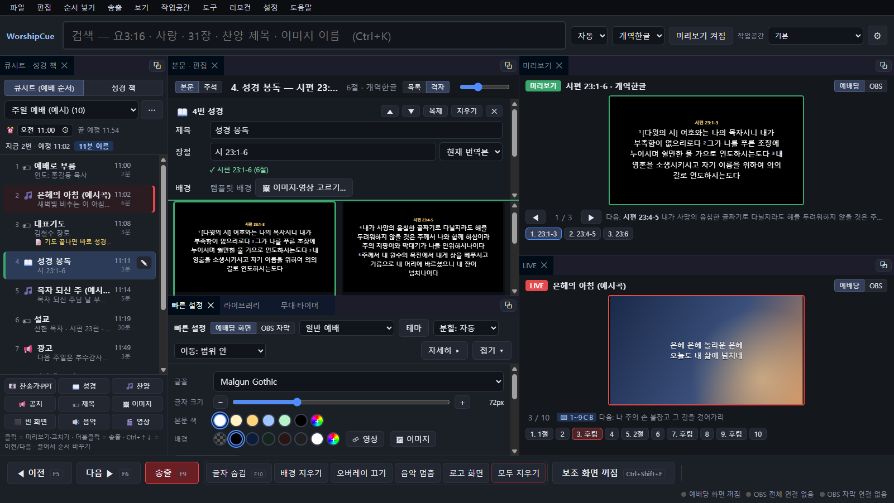

<sub>왼쪽: 큐시트(예배 순서·예정 시각) · 가운데: 고른 순서의 편집칸과 슬라이드 · 오른쪽: 미리보기(초록)와 LIVE(빨강). 화면의 이름·가사는 모두 예시입니다.</sub>

## 목차

- [5분 만에 시작하기](#5분-만에-시작하기)
- [주요 기능](#주요-기능)
- [메뉴 한눈에](#메뉴-한눈에)
- [그림으로 보는 사용법](#그림으로-보는-사용법) — 예배 준비 · AI 주보 · 예배 진행 · 무대 화면·리모컨 · 슬라이드 편집 · 끌어다 놓기 · 화면 테마 · 작업공간 · 예배 전 화면 · 찬양팀(코드·그룹 색·두 언어) · 화면에 그리기 · 찬양 가져오기·스트림덱·카메라
- [자세한 기능](#자세한-기능) — 큐시트 항목 · 라이브러리 · 찬송가·찬양 PPT · 송출 디자인 · 출력
- [단축키](#단축키) · [문제 해결](#문제-해결) · [성경 데이터와 저작권](#성경-데이터와-저작권) · [개발](#개발)

## 5분 만에 시작하기

1. **받아서 실행**: [Releases](https://github.com/hahadark/WorshipCue/releases/latest) 의 `WorshipCue-…-Portable.exe` (설치 없음)
2. **예배당 화면**: 보조 모니터를 연결하고 하단 `보조 화면` (Ctrl+Shift+F). 모니터는 `설정 → 출력`
3. **OBS** (방송할 때): 브라우저 소스 `http://127.0.0.1:37528/outputs/main` (전체) · `/outputs/overlay` (하단 자막) → [OBS 설정 가이드](docs/OBS설정가이드.md)
   - **자막 PC 와 송출(OBS) PC 가 따로일 때**: `설정 → 출력 → 내부망 출력` 을 켜고, 나오는 주소(`http://192.168.x.x:37550/outputs/overlay?key=…`)를 송출 PC 의 OBS 브라우저 소스에 넣으세요. 출력 화면만 열리고 조작 화면은 열리지 않습니다.
4. **찬송가 PPT 폴더**: 탐색기에서 폴더를 '라이브러리' 패널(찬송가·PPT 탭)에 끌어다 놓기
5. **큐시트 만들기**: `파일 → 🤖 주보로 큐시트 만들기` 로 주보에서 한 번에, 또는 왼쪽 아래 단추로 순서를 하나씩
6. **예배 중**: 첫 순서를 더블클릭(F9) → 그다음은 **F6** 만. 갑자기 나온 구절은 검색창에 `요 3 16` → Ctrl+Enter

## 주요 기능

| 구분 | 기능 |
|---|---|
| **예배 준비** | 큐시트(예배 순서) · 가운데 편집칸에서 바로 고치기 · 순서별 배경·템플릿·예정 시간·메모 · 큐시트 복제(다음 주) |
| | 🤖 **AI 주보 → 큐시트**: 키 없이 채팅 AI(ChatGPT·Claude·Gemini), 또는 오픈라우터 API 키로 자동. 찬송가 PPT·장절까지 연결 |
| | 🎼 찬송가·찬양 PPT (악보 배경 바꾸기 · OBS 에는 가사만) · 🎵 찬양 부를 순서(1절 후렴 2절 후렴) |
| | ✏ **슬라이드 편집** (FreeShow 방식): 글상자 끌어 옮기기·크기, 화면에서 바로 글 고치기, 글상자·그림·도형, 공통/슬라이드별 꾸미기 |
| | 📂 **끌어다 놓기**: 탐색기의 PPT·그림·영상·음악·가사 txt → 큐시트, 폴더 → 라이브러리 |
| | 📚 라이브러리: 찬양 · 찬송가·PPT · 이미지·영상 · 음악 · 오버레이(로고·시계·카운트다운·배너) · 템플릿 |
| **예배 진행** | F6 하나로 슬라이드 → 다음 순서 · 슬라이드 격자 · 찬양 중 숫자·C·B 로 절·후렴·브릿지로 바로 |
| | 예배 진행 시계 (순서별 예정 시각 · 몇 분 늦음) · 통합 검색 (성경·찬양·찬송가·이미지·영상·음악) |
| | 화면 지우기: 글자 · 배경 · 오버레이 · 음악 · 로고 화면 · 모두 |
| | 🖥 무대 화면(설교자·찬양팀 모니터: 지금·다음 슬라이드, 설교 타이머, 메시지) · 📱 휴대폰 리모컨(QR·PIN) |
| **출력** | 예배당 전체화면 · OBS 전체 · OBS 하단 자막(가사만) · 무대 화면, 디졸브/컷 · 🎬 영상 순서·배경 영상 |
| **예배 전·찬양팀** | 🎞 예배 전 슬라이드쇼(자동 넘김·반복·카운트다운·배경 음악) · 순서별 자동 넘김 · 송출할 때 자동 동작(타이머·무대 메시지·로고·오버레이) |
| | 그룹 색(1절·후렴·브릿지) · 찬양팀용 코드(무대 화면만) · 두 언어(병행 성경·가사 번역 줄) · 곡 정보(작사·작곡) |
| | ✎ 화면에 그리기·강조 · 📥 찬양 가져오기(OpenLP·ChordPro·ProPresenter 6·PPT) · 🎛 스트림덱·Companion · 📷 카메라(송출 배경 층·카메라 순서·편집기 상자) |
| **조작 화면** | 작업공간(예배 준비·예배 중·간단·내 배치) · 🎨 화면 테마 5가지 + 글자 크기 · OBS 처럼 패널 끌어 배치 |

## 메뉴 한눈에

| 메뉴 | 들어 있는 것 |
|---|---|
| 파일 | 📋 큐시트 관리 · 🤖 주보로 큐시트 만들기 · **📥 가져오기 ▸**(찬양 · 성경 번역본) · 송출 기록 · **⚙ 설정 (Ctrl+,)** · **설정 바로 가기 ▸**(테마·템플릿·출력·검색·단축키·성경 데이터) |
| 큐시트 | **＋ 순서 넣기 ▸**(찬송가·성경·찬양·공지·제목 / 이미지·영상·음악·슬라이드쇼·카메라·빈 화면) · **고른 순서**(편집칸에서 고치기 F2 · 슬라이드 편집 Ctrl+E · 위로·아래로·복제·지우기) · 편집칸 보이기 · ⏰ 예배 진행 시계 |
| 송출 | 송출 F9 · 다음/이전 슬라이드 · 다음/이전 순서 · **화면 지우기 ▸**(글자·배경·오버레이·로고 화면·음악·모두) · **송출 배경 ▸**(카메라·미디어) · ✎ 화면에 그리기 · 미리보기 끄기 · 보조 화면 |
| 보기 | **패널 ▸** · 슬라이드 격자 · **작업공간 ▸**(바꾸기 Ctrl+Alt+1~9 · 새로 저장 · 관리 · 잠그기·기본 배치) · 무대 화면 창 · 🎨 조작 화면 테마·글자 크기 |
| 도구 | **라이브러리 ▸**(찬양·찬송가·이미지·영상·카메라·음악·오버레이·템플릿) · 무대·설교 타이머 · 🎛 스트림덱·외부 단추 · **📱 휴대폰 리모컨 ▸**(열기·켜기/끄기·PIN — 켜져 있으면 '도구' 에 초록 점) |
| 도움말 | 사용 설명서 · 그림으로 보는 사용법 · OBS 연결 안내 · 단축키 · 정보 |

메뉴는 하는 일 순서대로(준비 → 송출 → 보기 → 도구) 6개로 두고, 긴 목록은 마우스를 올리면 옆으로 펼쳐지는 **▸ 하위 메뉴**에 넣었습니다. 같은 기능은 한 곳에만 있습니다.

화면 아래 송출 줄에는 자주 쓰는 단추(이전 · 다음 · 송출 · 글자 숨김 · 모두 지우기 · 보조 화면)만 두고, 배경 지우기 · 오버레이 끄기 · 로고 화면 · 음악 멈춤은 **`지우기 ▾`** 에 모았습니다 (켜진 것이 있으면 단추에 '로고 화면 ▾' 처럼 표시). 큐시트 아래 순서 넣기 단추도 찬송가·성경·찬양·공지·제목만 두고 나머지는 **`＋ 더보기 ▾`** 에 있습니다. 어디서든 **오른쪽 클릭**하면 그 자리에서 쓸 수 있는 기능만 모은 메뉴가 나옵니다.

| 큐시트 메뉴 | 송출 메뉴 |
|---|---|
| 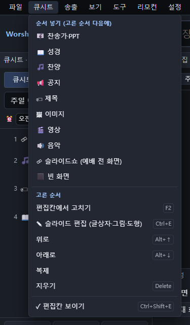 | 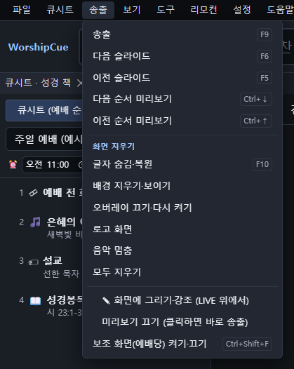 |

## 그림으로 보는 사용법

### 1. 예배 순서 만들기 (예배 전)

메뉴 `보기 → 작업공간 → 예배 준비` (Ctrl+Alt+2) 로 바꾸면 편집칸과 라이브러리가 크게 나옵니다.

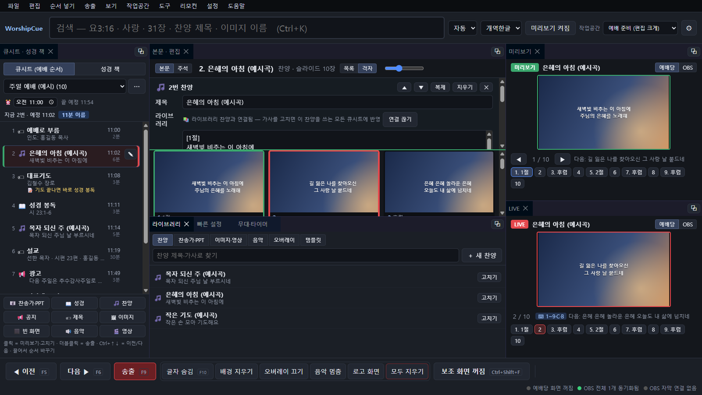

1. 왼쪽 아래 단추(또는 메뉴 `큐시트 → 순서 넣기 ▸`)로 순서를 넣습니다: 🎼 찬송가·PPT · 📖 성경 · 🎵 찬양 · 📢 공지 · 🏷 제목, 그리고 `＋ 더보기 ▾` 에 🖼 이미지 · 🎬 영상 · 🔊 음악 · 🎞 슬라이드쇼 · 📷 카메라 · ⬛ 빈 화면. 새 순서는 고른 순서 바로 다음에 들어갑니다.
2. 순서를 클릭하면 가운데 편집칸에서 바로 고칩니다 (입력 즉시 저장, 저장 단추 없음). 편집칸은 가운데 위 `✎ 편집칸` 단추 · Ctrl+Shift+E 로 보이기·숨기기 (숨기면 순서를 클릭해도 미리보기만).
3. 어디서든 **오른쪽 클릭**하면 그곳에 맞는 메뉴가 나옵니다 (아래 표).
4. 찬양은 가사에 `[1절]` `[후렴]` 을 한 번씩만 쓰고 '부를 순서' 에 `1절 후렴 2절 후렴` (또는 `1 C 2 C`).
5. (선택) `큐시트 → ⏰ 예배 진행 시계` 를 켜면 예배 시작 시각과 순서마다 예정 시간(분)으로 순서별 예정 시각·몇 분 늦음이 보입니다 (기본은 꺼짐).
6. **큐시트 순서를 클릭·더블클릭하면 미리보기에만 나오고 예배당·OBS 화면에는 나가지 않습니다.** 내보낼 때는 `송출` (F9) · `다음` (F6), 또는 오른쪽 클릭 `송출`.
6. 자주 쓰는 찬양·배경 그림·영상·음악·오버레이는 **라이브러리** 패널에 모아 두고 더블클릭으로 넣습니다.

| 오른쪽 클릭하는 곳 | 메뉴 |
|---|---|
| 큐시트 순서 | 미리보기 · 송출 · 편집칸 · 슬라이드 편집 · 제목·메모·예정 시간 · 라이브러리에 저장 · 위로·아래로·맨 위·맨 아래 · 복제 · 지우기 · 이 다음에 넣기(9가지) |
| 큐시트 빈 곳 | 순서 넣기 · AI 주보 · 큐시트 관리 |
| 슬라이드 (격자·목록) | 미리보기 · 바로 송출 · 이 슬라이드 편집 · 이 순서 편집칸 · 목록/격자 |
| 성경 검색 결과 | 미리보기 · 바로 송출 · 이 본문을 큐시트에 넣기 · 장절·본문 복사 |
| 미리보기 · LIVE | 송출 · 이전/다음 · 다음 순서 · 화면 지우기(글자·배경·오버레이·음악·로고·모두) · 보조 화면 · 무대 화면 |
| 라이브러리 | 큐시트에 넣기 · 그 줄의 단추들(배경·전체 배경·로고·재생·고치기·켜기/끄기·지우기) |
| 슬라이드 편집기 | 글 고치기 · 복제 · 앞/뒤 · 지우기 · 덧붙이기 · 되돌리기 · 슬라이드 초기화 |
| 글 입력칸 | 잘라내기 · 복사 · 붙여넣기 · 모두 선택 |

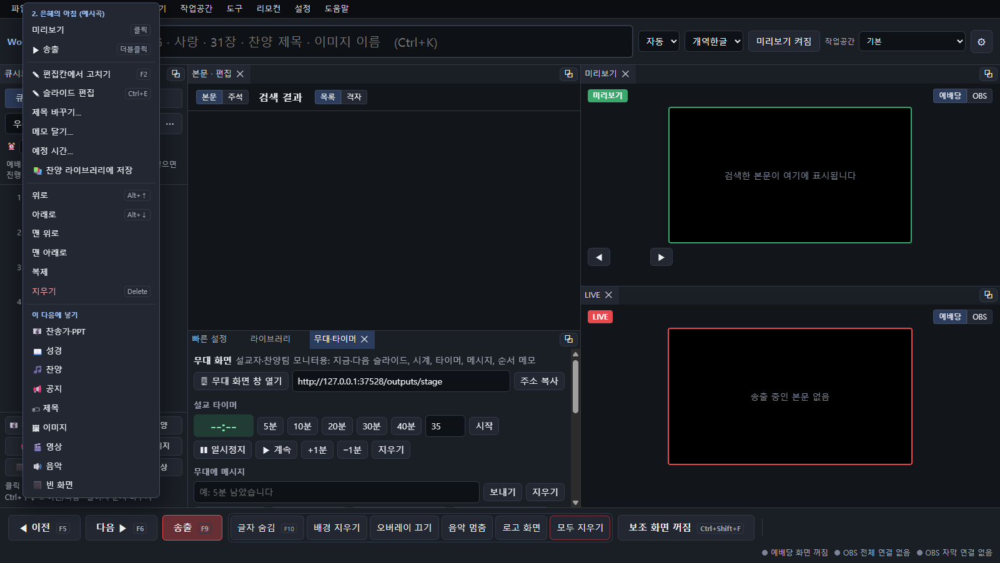

| 이미지·영상 | 오버레이 (시계·카운트다운·배너) |
|---|---|
| 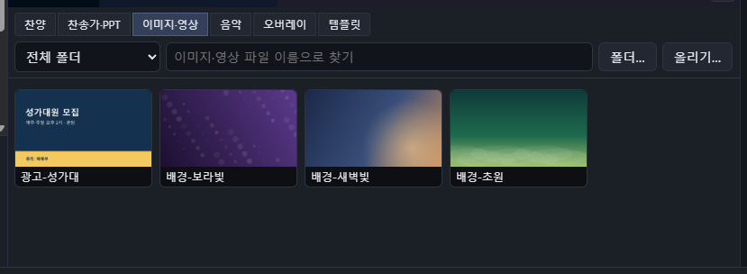 | 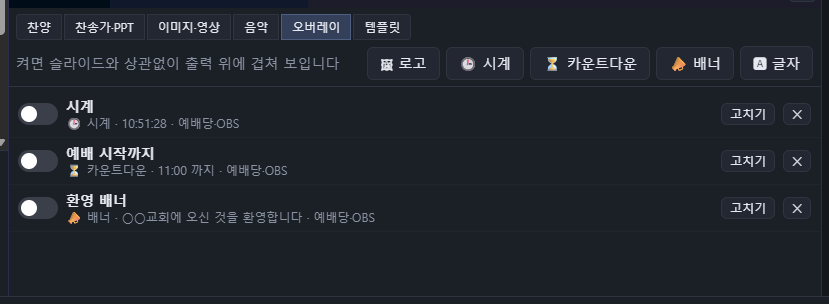 |

### 2. 🤖 주보로 큐시트 한 번에 (AI)

메뉴 `파일 → 주보로 큐시트 만들기`. AI 가 주보에서 예배 순서를 읽고, 찬송가 번호는 등록한 찬송가 PPT 와, 장절은 성경 DB 와 연결합니다. 못 찾은 것은 '확인할 것' 으로 알려 줍니다.

| 💬 채팅 AI로 (키 없이) | 🔑 API 키로 (자동) |
|---|---|
| 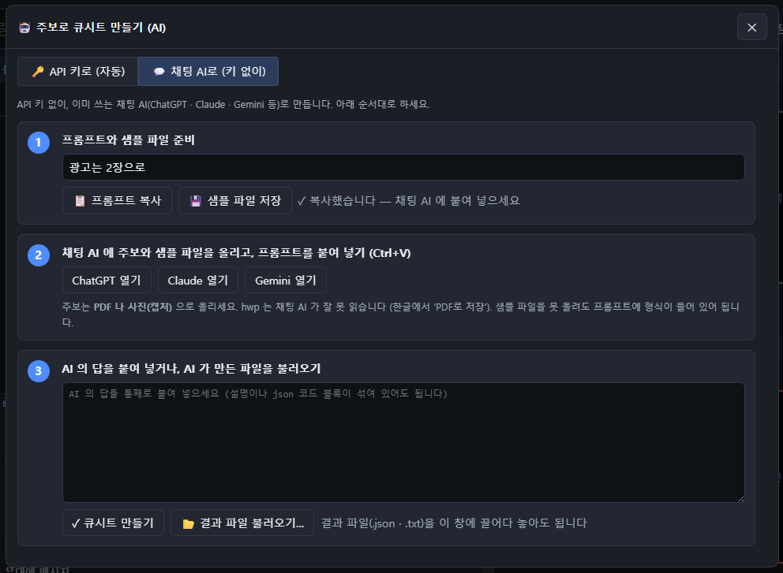 | 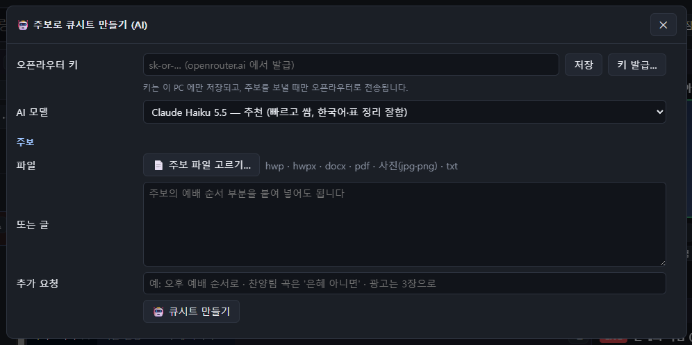 |

- **채팅 AI로 (키 없이)**: 이미 쓰는 ChatGPT · Claude · Gemini 에서 합니다. ① `프롬프트 복사` · `샘플 파일 저장` ② 채팅 AI 에 주보(PDF·사진)와 샘플 파일을 올리고 프롬프트 붙여 넣기 ③ AI 의 답을 붙여 넣거나 AI 가 만든 파일을 불러오기·끌어다 놓기. hwp 는 채팅 AI 가 잘 못 읽으니 PDF 로 저장해 올리세요.
- **API 키로 (자동)**: [오픈라우터](https://openrouter.ai) 키를 한 번 넣으면(이 PC 에만, Windows 보호 기능으로 암호화) 주보 파일(hwp · hwpx · docx · pdf · 사진 · txt)을 고르는 것만으로 끝. 추천 모델: `anthropic/claude-haiku-5.5` (빠르고 쌈, 주보 한 번에 약 $0.001) · PDF·사진은 `google/gemini-3.8-flash` · 복잡한 주보는 `anthropic/claude-sonnet-5.5`
- 주보 내용은 만들 때만 그 AI 서비스로 보내집니다. AI 결과이니 송출 전에 한 번 확인하세요.

### 3. 예배 진행 (예배 중)

`보기 → 작업공간 → 예배 중` (Ctrl+Alt+3): LIVE·미리보기가 크고, 가운데에 슬라이드 격자, 아래에 설교 타이머.

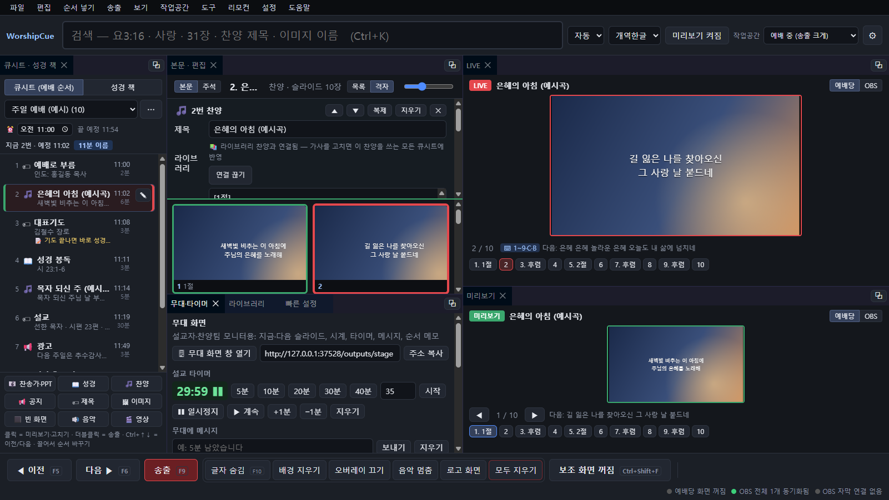

- 첫 순서를 **더블클릭**(또는 F9) → 그다음은 **F6** 만 누르면 슬라이드 → 다음 순서로 차례대로 넘어갑니다. Ctrl+↓ 는 다음 순서를 미리보기만.
- 찬양 중 `1`~`9` = 그 절, `C` = 후렴, `B` = 브릿지, `E` = 엔딩으로 바로 갑니다 (찬양팀이 후렴을 반복할 때).
- **슬라이드 격자**(가운데 `목록 | 격자`): 클릭 = 미리보기, 더블클릭 = 송출. 초록 = 미리보기, 빨강 = 송출 중.
- **통합 검색**: 검색창에 `은혜` → 성경 본문과 함께 라이브러리의 찬양·찬송가·이미지·영상·음악. `31` = 찬송가 31장.
- 아래 단추줄에서 필요한 층만 지웁니다 (켜진 단추는 노란색):

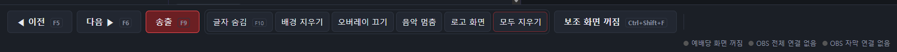

| 예배당 화면 (찬양) | 예배당 화면 (성경) |
|---|---|
|  | 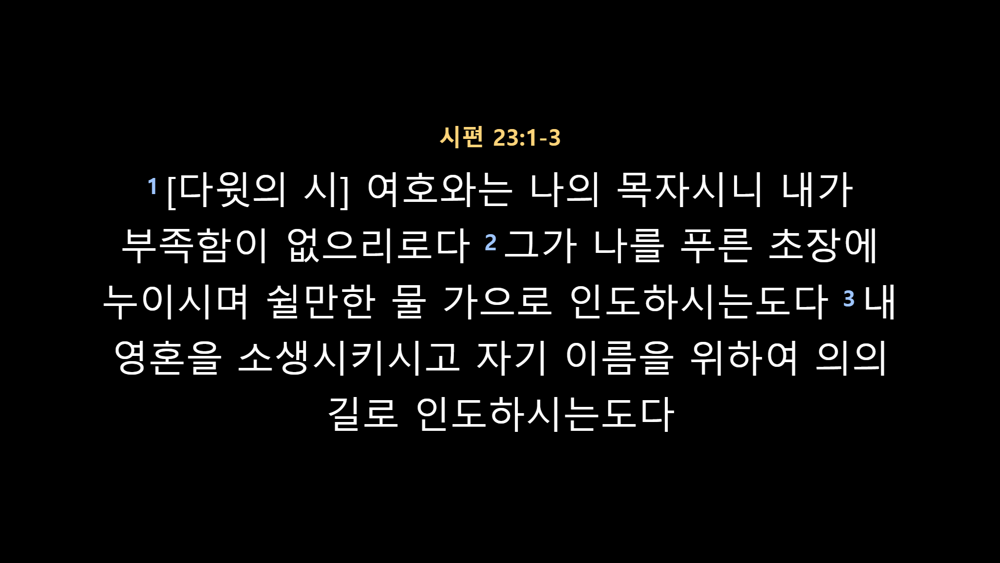 |

### 4. 설교자 모니터 · 휴대폰 리모컨

| 무대 화면 (지금·다음 슬라이드, 시계, 타이머, 메시지) | 휴대폰 리모컨 |
|---|---|
| 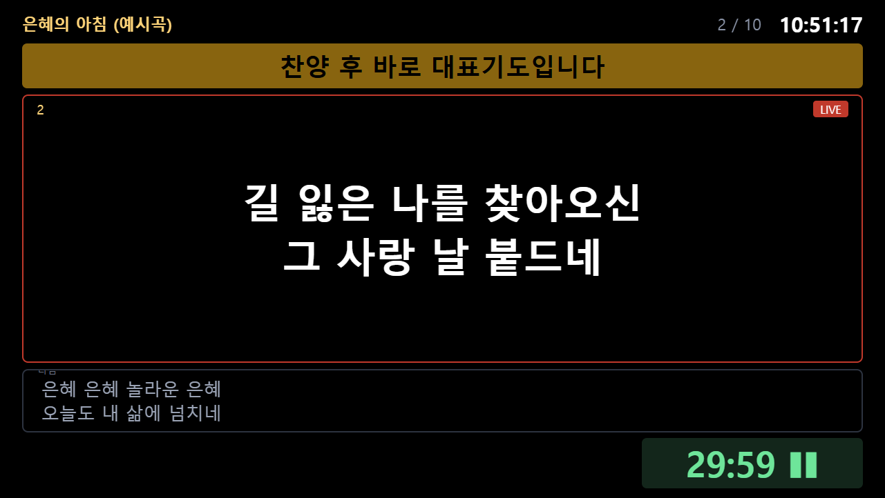 | 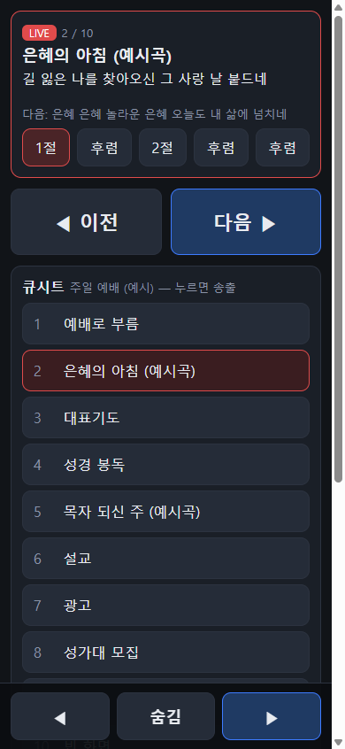 |

- **무대 화면**: `보기 → 무대 화면 창 열기` 를 설교자 모니터로 끌어다 놓거나, 주소 `http://127.0.0.1:37528/outputs/stage` 를 이 PC 의 브라우저·OBS 브라우저 소스로 엽니다 (보안상 다른 PC·태블릿에서는 열리지 않습니다). '무대·타이머' 패널에서 설교 타이머(5분 전 노랑, 지나면 빨강)와 전달 메시지('5분 남았습니다' 등).
- **휴대폰 리모컨**: 메뉴 **`도구 → 📱 휴대폰 리모컨`** → 켜기 → 휴대폰 카메라로 QR 을 찍고 PIN 입력. 같은 Wi-Fi 에서 이전·다음·숨김, 절·후렴 바로 가기, 큐시트 순서 송출, 무대 메시지·타이머. 켜져 있으면 메뉴 '도구' 에 초록 점. 처음 켤 때 Windows 방화벽 창이 뜨면 '개인 네트워크' 를 허용하세요.

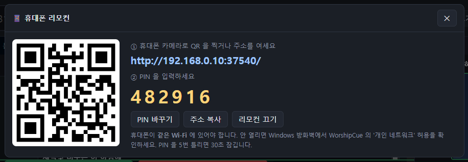

### 4-1. 🎛 OBS 안에 작은 조작판 (OBS 도킹)

방송 담당 한 사람이 OBS 하나만 보면서 가사까지 넘길 수 있습니다.

1. `설정 → 출력` 의 **OBS 도킹 (조작판)** 주소 `http://127.0.0.1:37528/dock` 을 복사
2. OBS → `도킹` → `사용자 지정 브라우저 도킹` → 이름 `WorshipCue`, 주소 붙여넣기 → 적용
3. OBS 한쪽에 지금·다음 슬라이드, ◀ 이전 · 다음 ▶ · 글자 숨김, 절·후렴 바로 가기, 큐시트(누르면 송출), 무대 메시지·타이머가 붙습니다

이 PC 안에서만 열리므로 PIN 이 필요 없습니다. 보조 화면을 끄면 OBS 화면(브라우저 소스)의 슬라이드도 같이 사라집니다 (`설정 → 출력` 에서 끌 수 있음).

### 5. ✏ 슬라이드 편집 (FreeShow 방식)

모든 순서(찬양·공지·제목·성경·찬송가·이미지·영상·슬라이드쇼·카메라·빈 화면)에서 편집칸의 `✏ 슬라이드 편집` (또는 격자 썸네일의 ✏ · 오른쪽 클릭 · **Ctrl+E**).

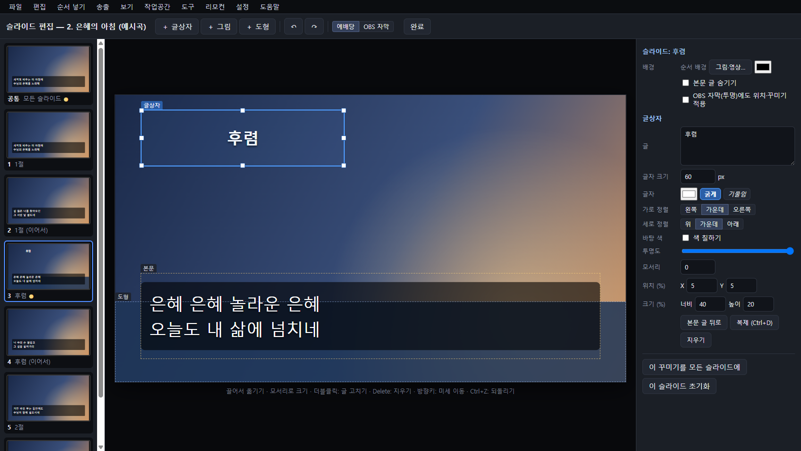

- 글상자를 **끌어 옮기고** 모서리로 크기 조절 (가운데·가장자리에 자동으로 붙음, Alt = 안 붙음, Shift = 비율 유지)
- **더블클릭**하면 화면 위에서 바로 글 고치기 → 가사·공지 글에 그대로 반영 (`[1절]` 이름표는 그대로)
- 오른쪽에서 글자 크기·색·굵게·정렬·줄 간격·색 상자·그림자, 슬라이드 배경(그림·영상·색)
- `＋ 글상자` `＋ 그림` `＋ 도형`(띠·상자·타원)을 덧붙이고, 본문 글 앞·뒤로 배치
- 맨 위 **공통** = 모든 슬라이드에 적용 (슬라이드에서 따로 바꾼 것이 우선)
- 왼쪽 목록에서 **`＋ 슬라이드`**(Ctrl+Shift+N) · 슬라이드마다 ▲ ▼ 옮기기 · ⧉ 복제(꾸민 것도) · ✕ 지우기 — 가사·공지 글에 그대로 반영되고, 꾸민 것도 따라 옮겨집니다
- **썸네일에서 바로** ＋ (다음에 새 슬라이드) · ✕ (지우기/건너뛰기) — 마우스를 올리면 왼쪽 위에
- **글 서식**: 가사·공지 칸에서 글을 고르고 **Ctrl+B** 굵게 · 크기 · 색 (칸 아래 서식 도구, `**굵게**` `{크기:160}…{/크기}` `{색:#ff6b6b}…{/색}` 로 저장)
- 성경·찬송가·그림 같은 순서: 본문은 그대로 두고 위치·꾸미기, 사이에 **제목 카드 슬라이드 덧붙이기**(＋ 슬라이드), 필요 없는 슬라이드는 ⊘ **건너뛰기**(↺ 되살리기)
- **← → ↑ ↓ 슬라이드 이동** (글상자를 고른 동안은 그 상자 미세 이동, Esc 로 고름 풀기) · PageUp/Down · Home/End · Ctrl+Z / Ctrl+Y 되돌리기 · Delete 지우기
- OBS 자막(투명) 출력에는 글 내용만 반영하고, 'OBS 자막에도 적용' 을 켜면 위치·꾸미기도 반영

### 6. 📂 파일 끌어다 놓기

탐색기에서 파일을 조작 화면에 끌어다 놓으면 바로 들어갑니다. 화면 아래에 어디로 들어가는지 안내가 나옵니다.

| 놓는 곳 | 파일 | 결과 |
|---|---|---|
| 큐시트 (순서 위에 놓으면 그 다음에) | PowerPoint (`.ppt` `.pps` `.pptx` `.ppsx`) | 🎼 찬송가·PPT 순서 (`305 나 같은 죄인….ppt` 처럼 번호로 시작하면 '305장') |
| | 그림 · 영상 · 음악 | 🖼 이미지 · 🎬 영상 · 🔊 음악 순서 |
| | 가사 `.txt` | 🎵 찬양 순서 (빈 줄 = 슬라이드, `[1절]` 이름표) |
| 순서 편집칸 | 그림 · 영상 | 그 순서의 배경 |
| 라이브러리 패널 | 폴더 | 지금 탭(이미지·영상 / 음악 / 찬송가·PPT)의 폴더로 등록 |
| 슬라이드 편집기 | 그림 · 영상 | 놓은 자리에 그림 덧붙이기 |
| AI 주보 창 | 주보 · 채팅 AI 결과 파일 | 그 파일로 큐시트 만들기 |

등록한 폴더 밖의 파일도 끌어다 놓은 것은 열 수 있습니다 (최근 500개 기억).

### 7. 🎨 화면 테마 · 글자 크기

`보기 → 🎨 조작 화면 테마 · 글자 크기` 에서 조작 화면의 색을 고릅니다: **어둡게**(기본) · **고대비** · **밝게** · **따뜻하게** · **푸른 밤**. 글자 크기는 작게·보통·크게·아주 크게 (Ctrl+Shift+= / Ctrl+Shift+-). 송출 화면의 디자인은 따로('빠른 설정 → 테마') 고릅니다.

| 테마 고르기 | 밝게 |
|---|---|
| 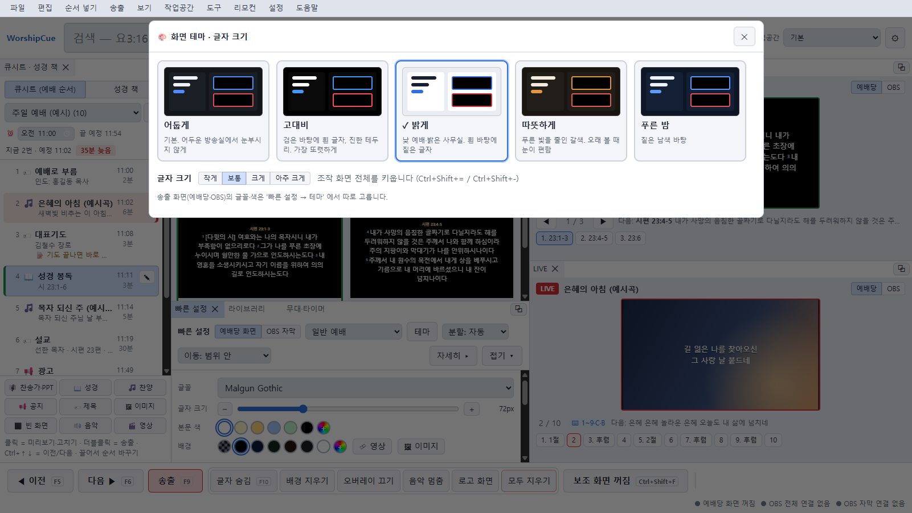 | 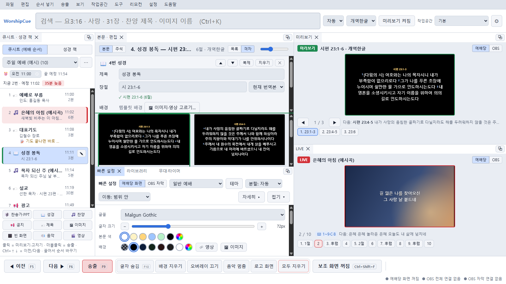 |

### 8. 작업공간 (화면 배치)

패널(큐시트 · 본문·편집 · 빠른 설정 · 라이브러리 · 무대·타이머 · 미리보기 · LIVE)은 **OBS 독처럼** 탭을 끌어 붙이고, 합치고, ⧉ 로 띄울 수 있습니다. 배치는 자동 저장됩니다.
배치를 `보기 → 지금 배치를 새 작업공간으로` 로 이름 붙여 두고, 상단 '작업공간' 선택칸이나 **Ctrl+Alt+1~9** 로 바꿉니다.

| 보기 메뉴 (패널 · 작업공간) | 작업공간 관리 |
|---|---|
| 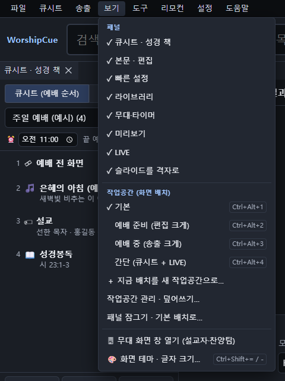 | 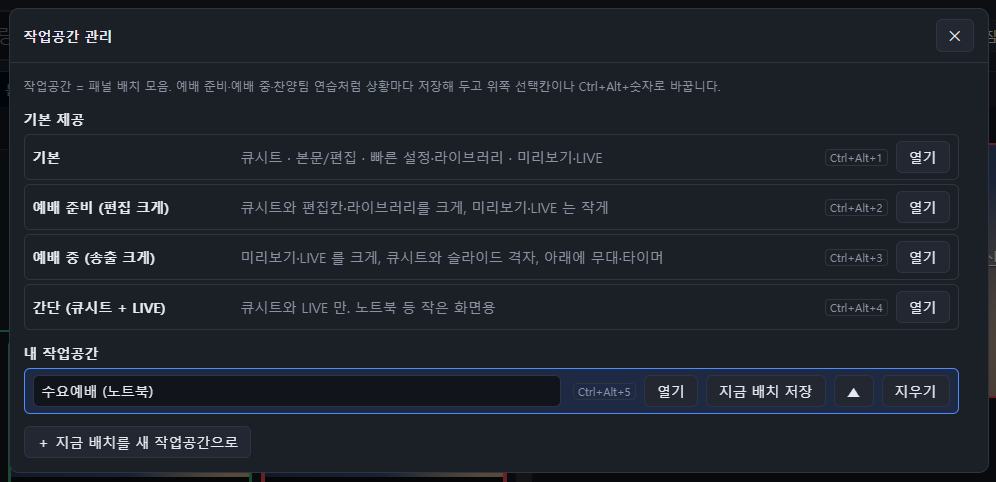 |

- 기본 제공: **기본** · **예배 준비**(편집 크게) · **예배 중**(송출 크게) · **간단**(큐시트 + LIVE, 노트북용)
- `보기 → 패널 잠그기 · 기본 배치로` 에서 **배치 잠그기**(예배 중 실수 방지)·기본 배치로 되돌리기
- 상단 `미리보기 켜짐` 을 누르면 **미리보기 끔 · 바로 송출** (OBS 스튜디오 모드 끄기와 같음)

### 9. 🎞 예배 전 화면 (슬라이드쇼)

`큐시트 → 순서 넣기 → 🎞 슬라이드쇼`. 광고 그림 여러 장(탐색기에서 편집칸에 끌어다 놓기)과 광고 글을 **N초마다 자동으로 넘기며 반복**하고, 오른쪽 아래에 **'예배 시작까지 09:50'** 카운트다운, 배경 음악을 함께 틉니다. 다음 순서를 송출하면 음악은 서서히 꺼집니다.

| 슬라이드쇼 편집칸 | 송출 화면 |
|---|---|
| 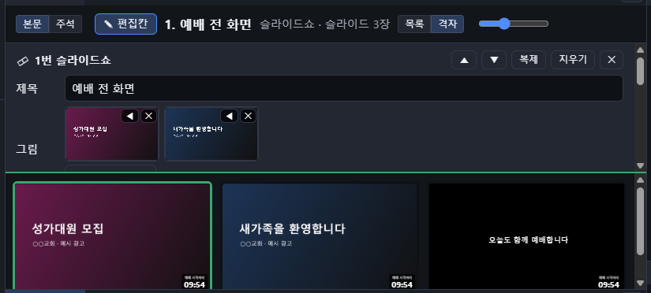 | 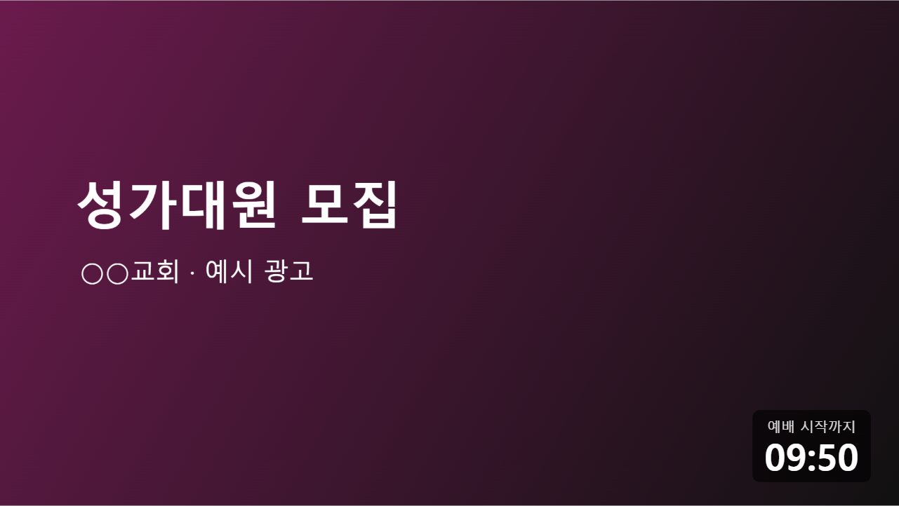 |

- **자동 넘김**은 모든 순서에 있습니다: 'N초마다 · 끝나면 처음부터 반복'(반복을 끄면 끝에서 다음 순서로). 숨김(F10) 중에는 멈춥니다.
- **송출할 때 자동으로** (순서 편집칸의 ⚡): 배경 음악 · 설교 타이머 N분 시작 · 무대 메시지 · 로고 화면 켜기/끄기 · 배경 지우기 · 오버레이 켜기/끄기 · 음악 멈춤. 예: '설교' 순서에 타이머 35분 → 설교 화면을 송출하면 타이머가 저절로 시작.

### 10. 찬양팀: 그룹 색 · 코드 · 두 언어 · 곡 정보

| 그룹 색 (1절 파랑 · 후렴 빨강 · 브릿지 보라) | 무대 화면: 코드는 찬양팀에게만 |
|---|---|
| 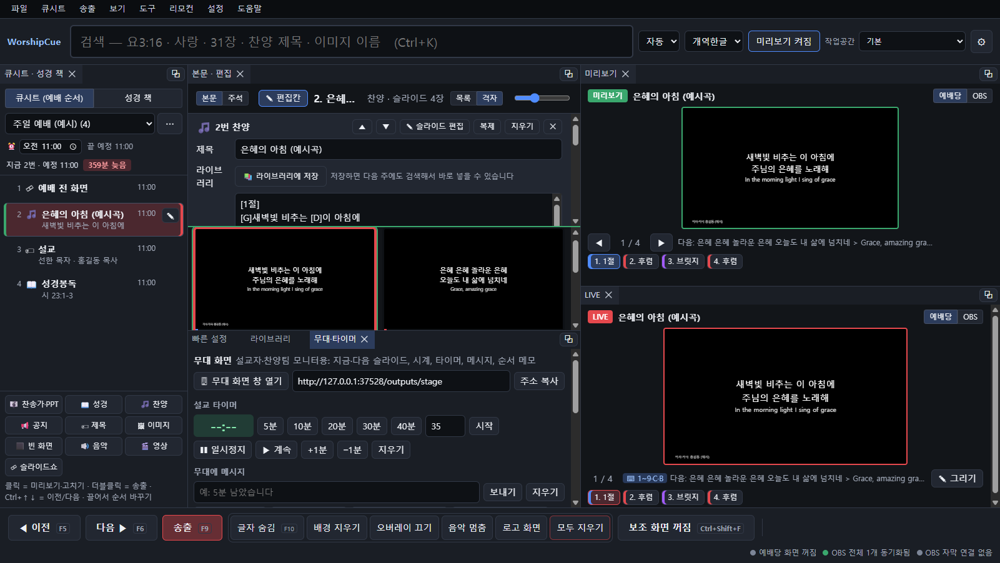 | 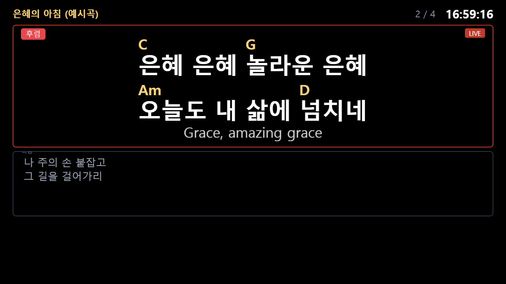 |

- **코드**: 가사에 `[G]새벽빛 비추는 [D]이 아침에` 처럼 쓰면 예배당·OBS 에는 가사만, **무대 화면에는 글자 위에 코드**가 나갑니다 (`/outputs/stage?chords=0` 이면 숨김).
- **두 언어**: 가사에서 `>` 로 시작하는 줄은 번역 줄(작게). 성경은 상단 **'병행'** 칸에서 두 번째 번역본을 고르면 절마다 아래에 함께 (예: 개역개정 + NIV).
- **곡 정보**: 찬양 편집칸의 '곡 정보'(작사·작곡·저작권)를 첫/마지막 슬라이드 아래에 작게 (OBS 자막에는 안 나감).

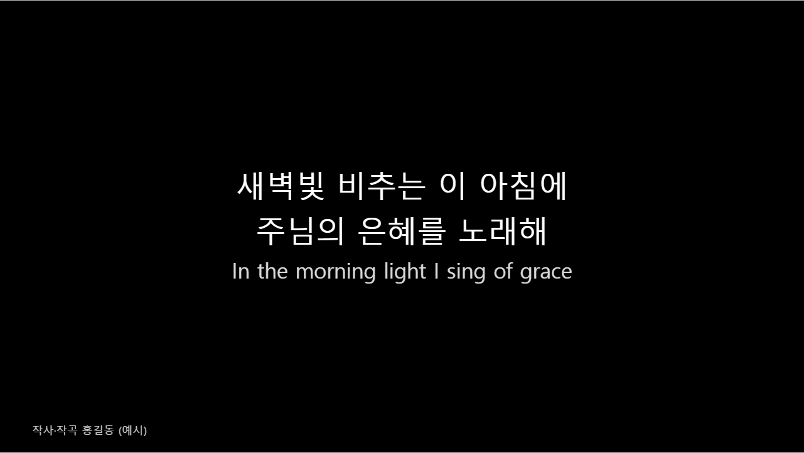

### 11. ✎ 화면에 그리기 · 강조

LIVE 아래 `✎ 그리기` (또는 `송출 → 화면에 그리기`) → LIVE 화면에 끌면 예배당·OBS 화면에 같은 선이 바로 그려집니다. 펜 5색·굵기·**형광펜**·**🔦 강조**(한 곳만 밝게, 휠로 크기)·되돌리기(Ctrl+Z)·지우기. 다음 슬라이드로 넘기면 저절로 지워지고, Esc 로 그리기를 끝냅니다.

| 조작 화면 (LIVE 위에서) | 송출 화면 |
|---|---|
| 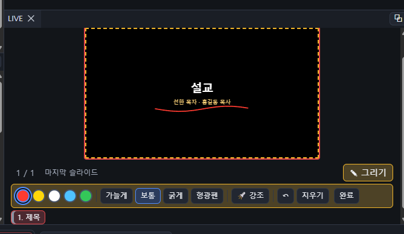 | 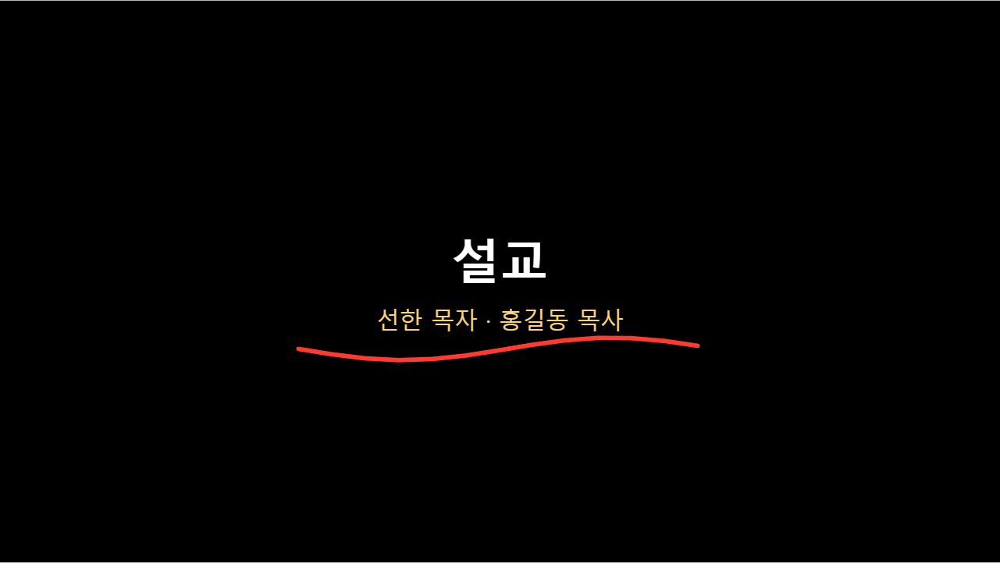 |

### 12. 찬양 가져오기 · 스트림덱 · 카메라 배경

- **📥 찬양 가져오기**: 라이브러리 '찬양' 탭의 `📥 가져오기…` 또는 파일·폴더를 찬양 탭에 끌어다 놓기. **OpenLP**(OpenLyrics .xml) · **ChordPro**(.cho) · **ProPresenter 6**(.pro6) · PPT 의 글자 · .txt — 이름표(1절·후렴)·부를 순서·코드·저작권까지 옮기고, 미리 보며 골라 저장합니다 (같은 제목은 건너뛰기·덮어쓰기·새로).
- **🎛 스트림덱·외부 단추**: `도구 → 스트림덱 · 외부 단추 연결` 의 주소(GET)를 Stream Deck 'Website'(백그라운드 요청)·Companion 'Generic HTTP' 단추에 넣으면 다음·숨김·로고·타이머 등을 누릅니다. 열쇠가 맞아야 동작하고 이 PC 안에서만 열립니다.
- **📷 카메라 (FreeShow 방식)**: 라이브러리 **'📷 카메라'** 탭에 연결된 웹캠·캡처보드·OBS 가상 카메라가 미리보기와 함께 나옵니다.
  - **▶ 송출 배경**(또는 더블클릭): 지금 송출 화면의 **배경 층**으로 바로 — 슬라이드는 그 위에, 다른 순서로 넘어가도 카메라는 그대로. 다시 누르거나 '배경 끄기' 로 끕니다. 그림·영상도 '이미지·영상' 탭의 `▶ 송출 배경` 으로 똑같이.
  - **순서로**: 카메라 화면 가득 나오는 📷 카메라 순서를 큐시트에 · **순서 배경**: 고른 찬양·공지의 배경으로 · **전체 배경**: 예배당 템플릿 배경으로
  - 슬라이드 편집기의 `＋ 카메라`: 슬라이드 안에 카메라 상자 (예: 설교자 화면 + 자막)
  - 예배당 화면용입니다. OBS 에서는 OBS 의 카메라 소스 위에 'OBS 자막' 을 겹치세요.

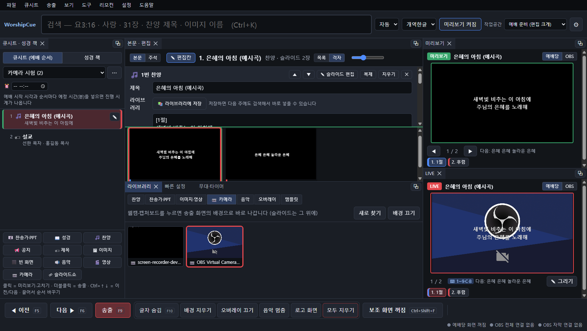

| 찬양 가져오기 | 스트림덱 · 외부 단추 |
|---|---|
| 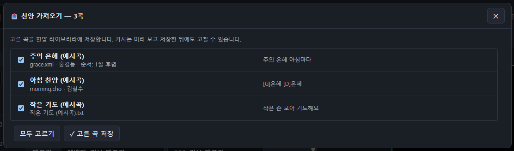 | 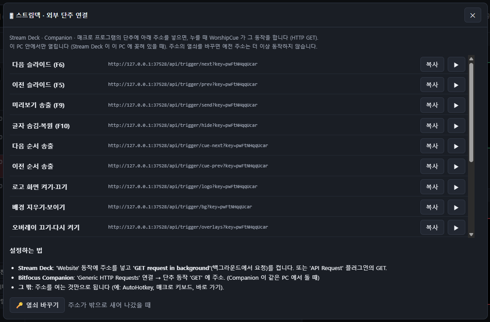 |

## 자세한 기능

### 큐시트 항목

| 종류 | 입력 | 화면 |
|---|---|---|
| 🎼 찬송가·PPT | 폴더의 `.pps` `.ppt` `.pptx` (번호·제목 검색, 없으면 온라인에서 찾기) | 악보 그림을 슬라이드로(**배경 따로 선택**) 또는 PPT 화면 그대로 |
| 📖 성경 | 장절 (`롬 8:18-25`, `시 23`), 번역본 | 화면에 맞게 자동 분할 |
| 🎵 찬양 | 제목, 가사, 부를 순서 | **빈 줄로 슬라이드 구분**, `[1절]` `[후렴]` 줄은 슬라이드 이름 (화면에는 안 나옴) |
| 📢 공지 | 제목, 내용 | `---` 줄로 슬라이드 구분, 제목이 위에 함께 |
| 🏷 제목 | 제목, 부제 | 예: "대표기도 / 홍길동 집사", "설교 / 제목 · 본문" |
| 🖼 이미지 | 그림 파일 | 화면 전체 |
| 📷 카메라 | 웹캠·캡처보드 | 카메라 화면 가득 |
| 🎬 영상 | 영상 파일 | 화면 가득 재생 (소리·반복·끝나면 멈춤/숨김/다음 순서) |
| 🔊 음악 | 음악 파일 | 화면은 그대로 두고 재생, 다른 화면을 송출하면 페이드아웃 |
| 🎞 슬라이드쇼 | 그림 여러 장 · 광고 글 · 카운트다운 시각 · 배경 음악 | N초마다 자동으로 넘기며 반복 (예배 전 화면) |
| ⬛ 빈 화면 | 검은 화면 / 배경·로고만 | |

- 순서마다 **조작자 메모**(예: "설교 후 바로 광고") · 배경 이미지·영상 · **이 순서에만 쓸 템플릿**(예배당·OBS 각각) · **자동 넘김** · **송출할 때 자동으로**(배경 음악·타이머·무대 메시지·로고·오버레이)
- 끌어서(또는 Alt+↑↓) 순서 바꾸기, F2 편집, Delete 삭제
- **📋 큐시트 관리** (큐시트 위 📋 단추 · `파일 → 큐시트 관리`): 이름·날짜·순서 제목으로 찾기 · 예배 날짜/최근/이름순 · **📌 고정** · **📄 서식**(주일 낮·수요·새벽 예배 순서를 서식으로 두고 '서식에서' 새로 만들기) · **메모** · **⧉ 다음 주 순서로 복제**(날짜 +7일, 이름 속 날짜도) · **📋 순서지 복사**(글로 — 단톡방·문서에) · 여러 개 골라 내보내기·휴지통 · **🗑 휴지통**(30일 안에 되살리기)
- **⏰ 예배 진행 시계**는 기본으로 꺼져 있고, 필요하면 켭니다 (큐시트 관리 창 · `큐시트` 메뉴 · 설정)

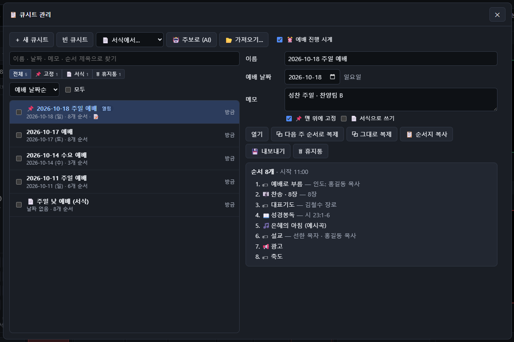

### 라이브러리

'라이브러리' 패널에서 자료를 모아 두고 큐시트에 넣습니다. **더블클릭 또는 Enter = 고른 순서 다음에 넣기**, 끌어서 큐시트에 놓아도 됩니다.

| 탭 | 하는 일 |
|---|---|
| 찬양 | 가사를 저장해 두고 매주 검색해서 넣기. 큐시트 순서와 **연결**되어 한 번 고치면 그 찬양을 쓰는 모든 큐시트에 반영 |
| 찬송가·PPT | 등록한 찬송가·PPT 폴더를 번호·제목으로 찾기 |
| 이미지·영상 | 그림·영상(mp4·webm·mov) 폴더 → 썸네일. '배경' = 고른 순서의 배경, '전체 배경' = 템플릿 배경, '로고' = 로고 오버레이 |
| 음악 | 음악 폴더(mp3·wav·m4a·ogg·flac) → ▶ 바로 재생, 재생 막대(일시정지·위치·볼륨·페이드아웃) |
| 오버레이 | 슬라이드와 따로 겹치는 층: **로고 · 시계 · 카운트다운(예: 11:00 까지 / 5분) · 배너 · 글자**. 켜기/끄기, 위치 9칸, 예배당/OBS 따로 |
| 템플릿 | 템플릿 미리보기. 예배당·OBS 에 적용하거나 **고른 순서에만** 적용 (예: 성경 봉독만 큰 글씨) |

**배경 영상**: 템플릿 배경(빠른 설정 → 배경 → 🎞 영상)이나 순서별 배경으로 영상을 쓰면 소리 없이 반복 재생하고, 가사를 넘겨도 끊기지 않습니다.

### 찬송가·찬양 PPT

PowerPoint 파일(`.pps` `.ppt` `.pptx` `.ppsx`)로 된 찬송가·교독문·찬양 폴더를 그대로 읽습니다.

1. 폴더 등록: 폴더를 라이브러리 패널(찬송가·PPT 탭)에 끌어다 놓거나, `🎼 찬송가·PPT → 찬송가 폴더·기본 배경 설정 → 📁 폴더 고르기…` (여러 개 가능: 새찬송가, 구세군 찬송가, 교독문 …)
2. 번호(`10`)나 제목(`전능왕`)으로 찾아 **Enter / 더블클릭** → 큐시트에 추가. 파일 이름이 `010 전능왕 오셔서.pps` 처럼 번호로 시작하면 번호로 찾습니다.
3. 악보(투명 그림)와 배경이 나뉜 파일은 **배경을 고를 수 있습니다**: 원래 배경 · 흰 배경(악보가 가장 또렷) · 템플릿 배경 · 다른 이미지. 전체 기본값은 찬송가 설정 창, 곡마다는 편집칸의 `배경`.
4. 폴더마다 **읽는 방식**: **자동**(악보·배경 나눔, PowerPoint 없어도 됨) / **화면 그대로**(PowerPoint 로 보이는 그대로, 형식이 제각각인 찬양 PPT 에 알맞음). `.pptx` 는 PowerPoint 가 있으면 화면 그대로, 없으면 글자와 배경만.
5. 교독문처럼 글자로 된 파일은 글자를 꺼내 원래 배경 위에 템플릿 글꼴로 띄웁니다. 꺼낸 그림은 `%APPDATA%\WorshipCue\data\hymn-cache` 에 저장되어 다음부터 바로 열립니다.

**OBS 에는 가사만 (하단 자막)**: 예배당 화면은 PPT 그림 그대로, OBS 자막에는 하단에 가사 글자만 나갑니다 (빠른 설정 → `PPT 슬라이드: 그림 그대로 / 가사만`). 가사는 ① PPT 안의 글자 ② **새찬송가 가사 DB**(베들레헴 성경의 `새찬송가.hdb`, 절·후렴을 악보 슬라이드 수에 맞게 나눔) 순서로 찾고, 편집칸의 `OBS 가사` 에 직접 고칠 수도 있습니다.

**온라인에서 찾기**: 내 폴더에 없는 곡은 `🌐 온라인에서 찾기` → 기본 브라우저에 찬양 PPT 사이트 검색 결과가 열리고, 브라우저에서 PPT 를 직접 받으면 20분 동안 다운로드 폴더를 지켜보다가 `문서\WorshipCue 찬양 PPT` 로 옮기고 큐시트에 자동으로 넣습니다. 프로그램이 사이트에서 몰래 자료를 받아 오지는 않습니다. 각 사이트의 이용 조건을 지켜 주세요.

### 송출 디자인 (템플릿·테마)

빠른 설정 → `테마` 에서 예배당 화면과 OBS 자막 디자인을 한 쌍으로 바꿉니다. 글꼴·크기·색·위치·내어쓰기·배경 이미지·로고는 빠른 설정에서 바로, 자세한 항목은 `설정 → 템플릿`.

- **구세군**: 레드 쉴드 · 깃발 · 성결 · 자선냄비 · 크레스트
- **방송 스타일**: 국내 여러 교회 예배 영상의 자막 화면 구성(위치·상자·색 계열)을 참고해 만든 5가지 — 그라데이션 상자 · 상자 없는 가사 · 전체 폭 하단 띠 · 흰 카드 · 가운데 작은 상자. 다른 교회의 로고·글꼴·이름은 들어 있지 않습니다.
- 화면 전환은 **디졸브**(새 화면이 서서히 겹쳐 나타남, 시간 조절)와 **컷** 중에서 출력마다 고릅니다 (빠른 설정 → 전환).

### 출력

| 출력 | 주소 · 방법 |
|---|---|
| 예배당 화면 | 보조 모니터 전체 화면 (하단 `보조 화면` · Ctrl+Shift+F) — 영상 소리는 여기서만 |
| OBS 전체 화면 | 브라우저 소스 `http://127.0.0.1:37528/outputs/main` |
| OBS 하단 자막 | 브라우저 소스 `http://127.0.0.1:37528/outputs/overlay` (투명 배경, PPT 는 가사만) |
| 무대 화면 | `http://127.0.0.1:37528/outputs/stage` (설교자·찬양팀 모니터) |

BibleCast 와 **동시에 실행할 수 있도록** 데이터 폴더(`%APPDATA%\WorshipCue`)와 포트(37528)를 따로 씁니다.

## 🍎 맥(macOS)에서 쓰기

- [Releases](https://github.com/hahadark/WorshipCue/releases/latest) 에서 `WorshipCue-…-mac-arm64.dmg` (M1·M2·M3… 애플 실리콘 맥 전용 — 인텔 맥은 지원하지 않음) 를 받아 열고, WorshipCue 를 `응용 프로그램` 폴더로 끌어다 놓습니다. 영어판은 `…-English-mac-….dmg`.
- **처음 열 때**: 애플 개발자 인증서로 서명하지 않은 프로그램이라 "확인되지 않은 개발자" 경고가 나옵니다. `응용 프로그램` 에서 WorshipCue 를 **오른쪽 클릭(Control+클릭) → 열기 → 열기**. (macOS 15 이상: 한 번 열어 본 뒤 `시스템 설정 → 개인정보 보호 및 보안` 맨 아래 **그래도 열기**.) "손상되었기 때문에 열 수 없습니다" 가 나오면 터미널에서 `xattr -cr /Applications/WorshipCue.app` 을 한 번 실행하세요.
- **단축키**: 윈도우의 Ctrl 은 맥에서 **⌘(Command)** 입니다 (예: ⌘K 검색 · ⌘E 슬라이드 편집 · ⌘B 굵게 · ⌘⇧F 보조 화면). 화면에도 ⌘ 로 보입니다. 맥북에서 F5·F6·F9·F10 은 **fn** 을 같이 누르거나, `시스템 설정 → 키보드 → 키보드 단축키 → 기능 키` 에서 'F1, F2 등의 키를 표준 기능 키로 사용' 을 켜세요. 단축키는 `설정 → 단축키` 에서 바꿀 수 있습니다.
- **카메라**: 처음 쓸 때 카메라 허용 창이 뜹니다. 거절했다면 `시스템 설정 → 개인정보 보호 및 보안 → 카메라` 에서 WorshipCue 를 켜세요.
- 맥에서 안 되는 것: 찬송가 PPT 의 '화면 그대로' 읽기 (윈도우 PowerPoint 필요 — 맥에서는 '자동' 방식으로 읽음).

## 단축키

| 키 | 기능 |
|---|---|
| F6 / F5 | 다음 / 이전 슬라이드 — 순서의 끝이면 **다음 순서로** |
| ← / → · PageUp / PageDown | 미리보기 이전 / 다음 슬라이드 (← → 는 글 쓰는 칸 밖에서) |
| F9 · 슬라이드 더블클릭 | 송출 (큐시트 순서 클릭·더블클릭은 미리보기만) |
| F10 | 글자 숨김·복원 |
| Ctrl+↓ / Ctrl+↑ | 다음 / 이전 순서 미리보기 (송출은 그대로) |
| 1~9 · C · B · E (찬양 송출 중) | 그 절 · 다음 후렴 · 브릿지 · 엔딩으로 바로 |
| Ctrl+K · Enter · Ctrl+Enter | 즉석 검색(성경·찬양·찬송가…) · 미리보기 · 바로 송출 |
| F2 | 고른 순서 제목 고치기 (편집칸) |
| Ctrl+E | 슬라이드 편집 (지금 미리보기 슬라이드) |
| Ctrl+Shift+E | 편집칸 보이기·숨기기 |
| Ctrl+Alt+1~9 | 작업공간 바꾸기 |
| Ctrl+Shift+= / Ctrl+Shift+- | 조작 화면 글자 크게 / 작게 |
| Ctrl+Shift+F | 보조 화면(예배당) 켜기·끄기 (보조 화면을 클릭해 선택했으면 Esc 로도 끔) |
| Ctrl+H | 송출 기록 |
| Esc | 보조 화면 끄기 (열린 창이 있으면 창 닫기) |

모든 단축키는 `설정 → 단축키` 에서 바꿀 수 있습니다. 자동으로 다음 순서로 넘어가는 기능은 `설정 → 검색·분할 → 큐시트` 에서 끌 수 있습니다.

## 문제 해결

| 증상 | 확인 |
|---|---|
| 예배당 화면이 안 나옴 | `설정 → 출력` 에서 모니터 확인, 하단 `보조 화면` (Ctrl+Shift+F) |
| OBS 에 안 나옴 | 하단 상태에 "OBS … 연결 없음" 이면 브라우저 소스 주소·포트 확인 |
| 휴대폰 리모컨이 안 열림 | 같은 Wi-Fi 인지, Windows 방화벽에서 WorshipCue '개인 네트워크' 허용 확인 |
| 찬송가 PPT 가 그림으로 안 나옴 | '화면 그대로' 방식과 `.pptx` 는 PowerPoint 필요. 없으면 폴더 읽는 방식을 '자동' 으로 |
| 채팅 AI 가 주보를 못 읽음 | hwp 대신 PDF·사진으로. 답에서 큐시트를 못 찾으면 "JSON 코드 블록 하나로 다시 답해 줘" |
| 편집칸이 안 보임 | 가운데 위 `✎ 편집칸` 단추 · F2 · Ctrl+Shift+E (✕ 로 닫으면 숨김 상태로 기억) |
| 화면 배치가 이상함 | `보기 → 패널 잠그기 · 기본 배치로` (또는 Ctrl+Alt+1) |
| 조작 화면 글자가 작거나 흐림 | `보기 → 화면 테마` 에서 '고대비' 나 글자 '크게' (Ctrl+Shift+=) |

더 자세한 내용은 [사용자 설명서](docs/사용자설명서.md#10-문제-해결).

## 성경 데이터와 저작권

- 기본은 **개역한글**입니다. 개역개정 등은 [베들레헴 성경](https://bethlehembible.org/setup/#%EC%9C%88%EB%8F%84%EC%9A%B0)을 설치한 뒤 **설정 → 성경 데이터 → 자동으로 찾기** 로 가져오세요 ([자세한 방법](https://github.com/hahadark/BibleCast#성경-데이터-설치)).
- 성경 본문(개역한글 제외)·주석서·찬송가·악보·찬양 가사·찬양 PPT 는 들어 있지 않습니다. 각 저작권자의 허락 범위(교회 저작권 라이선스 등) 안에서 사용하세요.
- 구세군 레드 쉴드·크레스트 로고는 구세군(The Salvation Army)의 상표이며, 구세군 교회·기관의 예배 송출용으로 포함했습니다.

## 개발

```
npm install
npm start          # 실행
npm test           # 자동 테스트
npm run dist       # Windows 설치판·휴대판 (dist/)
```

| 부분 | 파일 |
|---|---|
| 코어 (명령·상태) | `src/core/core.js` · 송출 `presentation.js` · 서버 `server.js` |
| 큐시트 저장·검증 | `src/core/cues.js` · `db.js` · 슬라이드 편집 검증 `slideedit.js` |
| AI 주보 | `src/core/bulletin.js` (프롬프트·채팅 AI 답 읽기·큐시트로) |
| 찬송가·라이브러리·리모컨 | `src/core/hymns.js` · `library.js` · `remote.js` |
| 조작 화면 | `src/web/control/` (`cue.js` 큐시트 · `slideedit.js` 편집기 · `dock.js` 배치·작업공간 · `uitheme.js` 화면 테마 · `dropfiles.js` 끌어다 놓기) |
| 슬라이드·렌더링 (모든 출력 공통) | `src/web/shared/slides.js` · `render.js` · 그룹 색·코드 `groups.js` |
| 찬양 가져오기 · 외부 단추 | `src/core/songimport.js` · `core.js` 의 `trigger` (`GET /api/trigger/<동작>?key=…`) |
| 데스크톱 (Electron) | `src/main/main.js` · `preload.js` (끌어다 놓은 파일 경로만) |

외부 연동 명령: `POST http://127.0.0.1:37528/api/command` (헤더 `X-WorshipCue: 1`) — `listCues`, `getCue`, `saveCue`, `nextSlide`, `toggleLive` …

함께 쓰는 공개 라이브러리: [dockview-core](https://github.com/dockview/dockview) 8.4.0 (MIT, `src/web/shared/vendor/dockview-core.LICENCE.md`) · [qrcode-generator](https://github.com/kazuhikoarase/qrcode-generator) 2.0.4 (MIT, 리모컨 QR 코드)
